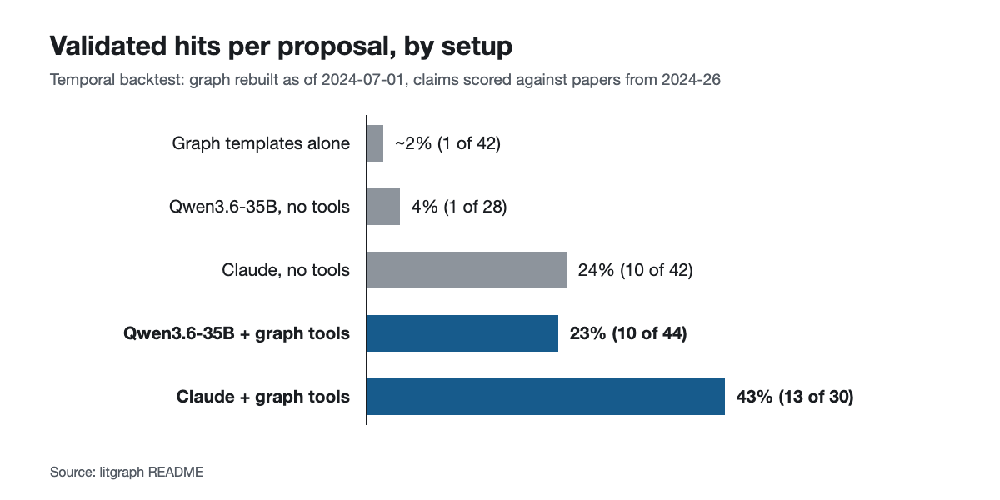

# LitGraph

A knowledge-graph gap explorer over the LLM research literature (RAG, agent
memory, agent harnesses — recently widened to diffusion LLMs, RL-for-LLM,
model forensics, foundations, and image-gen/omni-modal). It ingests papers and
blog posts, extracts a typed entity graph, finds structurally under-explored
regions, has LLMs propose concrete research gaps seeded by those regions, and
then tries very hard to **kill** every proposal with an adversarial critic
ensemble. What survives is published as evidence-grounded gap dossiers.

**The headline deliverable: [48 surviving gap dossiers](data/frontier-gaps-2026-07-19.json)
— browse them on the [review page](https://gaztrabisme.github.io/litgraph/).**
We built the machine; we are not domain experts on all 8 topic families it now
spans. If you know a paper that closes one of these gaps, [dispute
it](../../issues/new?template=dispute-gap.md).

Most of the pipeline runs on **local models** (Qwen3.6-35B-A3B + Jina v5
embeddings on a Mac via [oMLX](https://github.com/omlx)); extraction over the
full 1,285-doc corpus cost about **$2** on deepseek-v4-flash. Only the
cross-family auditor uses a frontier model (Claude, via the `claude` CLI).

## The architecture (and how it got inverted)

The original charter said *"structure proposes, LLM disposes"* — gap candidates
come from graph topology via typed templates, and the LLM's only job is to kill
them. A temporal backtest falsified half of that. The validated architecture is:

> **LLM proposes, structure informs and disposes.**

- **Structure informs:** structural holes (cluster pairs with far fewer
  cross-links than a null model expects) are computed from the graph and given
  to the proposer as *leads*, never as candidates.
- **LLM proposes:** an LLM session with read-only graph tools
  (`who_tried_this`, `full_text`, `evidence_for`, `subgraph_around`) explores
  the corpus from those leads and proposes claims, grounded in verbatim quotes
  that are mechanically verified against stored full text.
- **Structure disposes:** every proposal goes through a kill-gate — two
  isolated critics from different model families (local Qwen + DeepSeek), a
  relevance gate on every kill, resurrection review of unanimous kills, and a
  cross-family Claude audit of every survivor. Every verdict must cite
  in-index evidence, which is verified against stored text before it counts.

### Why believe any of this? The eval numbers, honestly

Everything was gated by a temporal backtest: rebuild the graph as of
2024-07-01, propose gaps inside that world, then score claims against what the
field actually published in 2024-26 (a HIT = an independent judge affirms a
post-cutoff paper closes the claim; scoring evidence must come from the index).

| arm (same cutoff, same kill-gate, same scoring) | proposals | validated HITs | HIT/proposal |
|---|---|---|---|
| graph templates alone (the original charter) | 42 scored | 1 | ~2% |
| Qwen3.6-35B, no tools | 28 | 1 | 4% |
| Claude, no tools | 42 | 10 | 24% |
| **Qwen3.6-35B + graph tools** | 44 | **10** | **23%** |
| **Claude + graph tools** | 30 | **13** | **43%** |



Graph tools lifted the local model **10x** — to parity with tool-less Claude —
and lifted Claude 1.8x. Pure structural templates were not competitive as
proposers, which is why they were demoted to leads. Zero contamination LEAKs
(claims "predicting" pre-cutoff work) were found in any decided case, and a
date-recallability probe showed 6 of Claude's 11 no-tools HITs close with
papers published after any plausible training cutoff — so the lift is not
just memorization. Full story with all the negative results:
[docs/writeup.md](docs/writeup.md).

## What's in the repo

| Path | What |
|---|---|
| `src/litgraph/` | The whole pipeline (~20 files: ingest, extract, resolve, graph, communities, templates, proposer, frontier, assassin, backtest) |
| `prompts/` | Versioned prompts — extraction, critics, proposers, judges (prompt changes are treated like schema migrations) |
| `data/frontier-gaps-2026-07-19.json` | **The 48 surviving dossiers** (claim + verbatim grounds + all critic verdicts) |
| `data/frontier-gaps-2026-07-19-contested.json` | 7 dossiers the critics could not agree on — explicitly awaiting human judgment |
| `data/seeds.yaml` | 42 hand-curated blog/repo seeds (all URLs verified live) |
| `data/longitudinal_results.json` | A rejected eval diagnostic, kept for the record (see wiki/decisions.md 2026-07-18) |
| `docs/` | The [writeup](docs/writeup.md) and the [review page](https://gaztrabisme.github.io/litgraph/) |
| `wiki/` | The actual lab notebook: dated logs, decision records, phase designs, failure post-mortems. Published as-is |
| `tests/` | 180 tests, all offline (LLM calls faked) |

**Not in the repo:** the DuckDB databases (~1.6 GB, contain full paper texts —
not redistributable) and the LLM call logs. You rebuild them by running the
pipeline; the dossier JSONs are the reproducible artifacts.

## Running it

Requirements — this is a personal research stack, and the defaults reflect it:

1. **Python ≥3.12 + [uv](https://docs.astral.sh/uv/)**.
2. **A local OpenAI-compatible server** for the adjudication model
   (`Qwen3.6-35B-A3B`) and embeddings (`jina-embeddings-v5-text-small`,
   1024-dim). We use oMLX on Apple Silicon; anything OpenAI-compatible works
   if you change the model names in `src/litgraph/models.py`. Set
   `OMLX_BASE_URL` / `OMLX_API_KEY`.
3. **A DeepSeek API key** (`DEEPSEEK_API_KEY`) for extraction and the second
   critic family. Extraction over ~1,300 docs ≈ $2.
4. **The `claude` CLI, authenticated** — the cross-family auditor,
   resurrection pass, and backtest closure judge shell out to `claude -p`.
   Without it, `assassinate` Stage D and `backtest score` won't run.
5. Run everything **from the repo root** (paths like `prompts/`, `logs/llm`,
   `data/seeds.yaml` are CWD-relative).

```bash
cp .env.example .env   # fill in keys
set -a; source .env; set +a
uv sync
uv run pytest          # 180 tests, offline

# Build the world (hours of wall time; extraction costs real money)
uv run litgraph ingest arxiv --max-results 170
uv run litgraph ingest seeds
uv run litgraph extract
uv run litgraph resolve
uv run litgraph graph
uv run litgraph embed-nodes
uv run litgraph communities

# Find gaps
uv run litgraph frontier leads          # structural holes as leads (read-only)
uv run litgraph frontier qwen           # hole-seeded local-model proposer sessions
uv run litgraph assassinate             # the kill-gate
uv run litgraph gaps --status survived  # dossiers as JSON
```

`litgraph stats` prints corpus/graph counts at any point. The temporal
backtest lives under `litgraph backtest` (see `wiki/phase3-design.md`).

## Prior art & credits

Built against, not instead of, existing work:

- **SciMuse** (arXiv 2405.17044) — concept-graph + GPT-4 idea generation; our
  read of its null results (topology alone doesn't select interesting pairs)
  shaped the architecture.
- **GAPMAP** (arXiv 2510.25055) — LLM gap detection; its model-family
  complementarity finding is why the kill-gate critics are cross-family.
- **Refute-or-Promote** (arXiv 2604.19049) — the adversarial kill-gate
  mechanics (refute mandate, isolated contexts, any-refutation-kills).
- **HySemRAG** (arXiv 2508.05666) — hybrid retrieval design menu.
- Design transplants (code is ours): Graphiti's bi-temporal ontology shape,
  ATOM's cosine merge, fast-graphrag's PPR usage, MS GraphRAG's Leiden
  community pass.

The lab notebook in `wiki/` names what we took from each and what we rejected.

## License

MIT.
